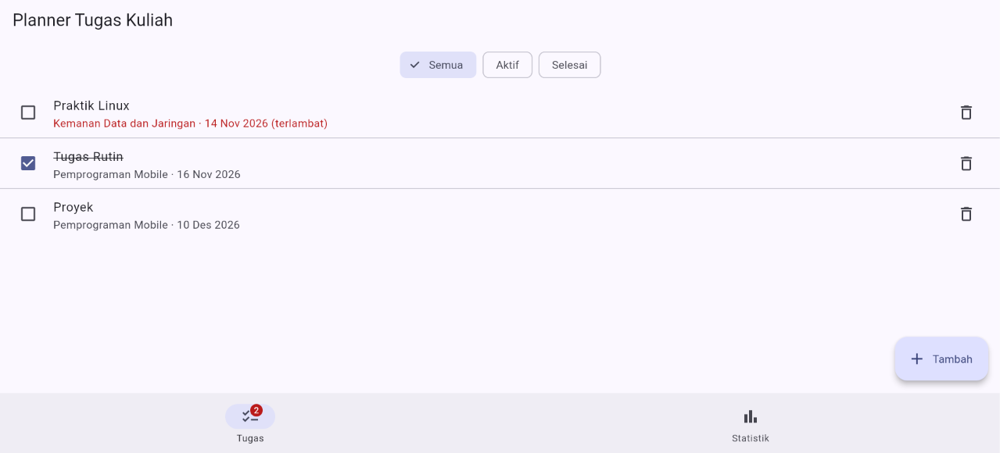
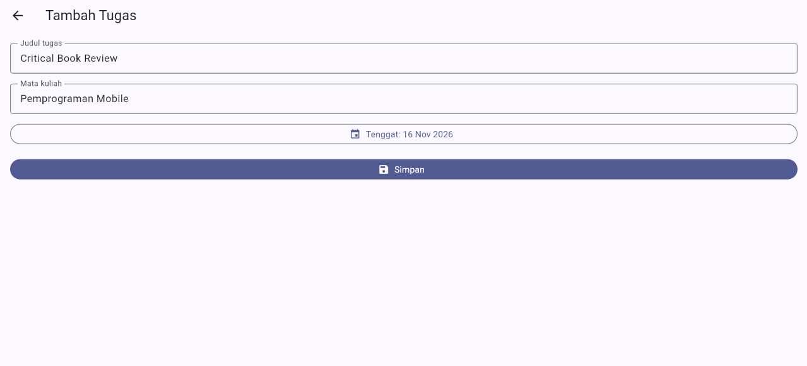
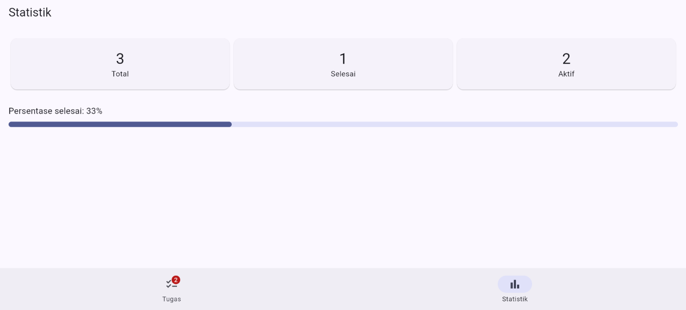

# Planner Tugas Kuliah — Tugas Rutin 7

## (a) Identitas

| | |
|---|---|
| Nama | Lastri P. Silaban |
| NIM | 4243250037 |
| Kelas | PSIK-24C |

## (b) Tangkapan Layar

**Halaman Daftar**



**Halaman Form**



**Halaman Statistik**



## (c) Letak Setiap State

```
ChangeNotifierProvider<PlannerModel>      <- STATE BERSAMA (di atas pohon)
└── MaterialApp.router (go_router)
    ├── Shell: KerangkaNavigasi           <- select(jumlahAktif) -> badge
    │   ├── HalamanDaftar                 <- watch(tugas); _filter = setState (LOKAL)
    │   └── HalamanStatistik              <- watch(total, selesai, persentase)
    └── HalamanForm                       <- controller + tanggal = LOKAL; simpan -> read().tambah()
```

| State | Letak | Alasan |
|---|---|---|
| Daftar tugas (judul, mata kuliah, tenggat, selesai) | `PlannerModel` (Provider) | Dibaca/diubah tiga halaman dan badge navigasi; harus bertahan saat pindah layar |
| Filter Semua/Aktif/Selesai | `setState` di `_HalamanDaftarState` | Hanya dipakai satu halaman (ephemeral state) |
| Isi kolom teks dan tanggal yang dipilih | `TextEditingController` (teks) dan `setState` (tanggal) di `_HalamanFormState` | Hanya bermakna selama form terbuka |
| Jumlah tugas aktif di badge | Turunan `PlannerModel.jumlahAktif` via `context.select` | Rebuild hanya saat angkanya berubah |

## (d) Penjelasan Lifecycle dan Pemilihan Provider

Pada `HalamanForm`, dua `TextEditingController` dibuat di `initState()` karena method ini hanya dipanggil sekali setelah State dibuat, sehingga controller tidak dibuat ulang setiap `build()`. Keduanya wajib dibuang di `dispose()` agar tidak terjadi kebocoran memori ketika halaman ditutup. Setelah `await showDatePicker`, saya memeriksa `if (!mounted) return;` sebelum memanggil `setState`, karena widget bisa saja sudah ditutup saat dialog tanggal terbuka. Filter pada halaman daftar memakai `setState` karena hanya dibutuhkan satu halaman. Dengan begitu, perubahan filter tidak ikut membangun ulang halaman lain.

Untuk state bersama saya memilih Provider dibanding Cubit. Cakupan aplikasi ini kecil (satu daftar tugas dengan tiga operasi), sehingga `ChangeNotifier` sudah cukup dan boilerplate-nya lebih sedikit dibanding membuat kelas state immutable dan `emit()`. Model tetap bebas dari pustaka UI sehingga dapat diuji dengan unit test biasa. Dengan `context.select`, badge navigasi hanya dibangun ulang saat jumlah tugas aktif berubah, sedangkan tombol dan checkbox memakai `context.read` di dalam callback. Secara non-teknis, kurva belajar Provider lebih rendah sehingga lebih cepat dikerjakan, mudah dipahami anggota tim lain, dan tetap bisa ditingkatkan ke Cubit bila fitur bertambah kompleks.

## (e) Pernyataan Penggunaan AI

Saya menggunakan AI sebagai asisten untuk membantu menyusun kerangka kode. Kode telah saya jalankan, pelajari, dan uji sendiri.